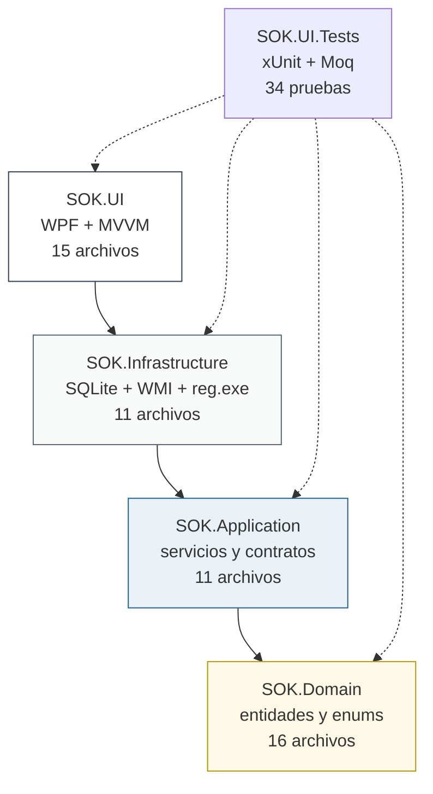
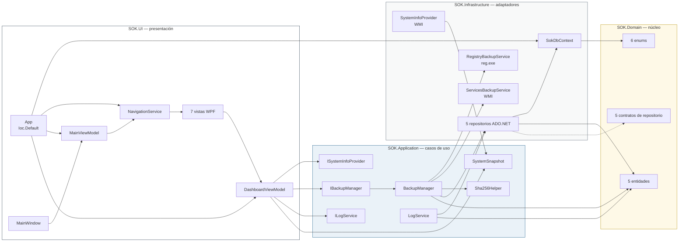

# Mapa conceptual del código de SOK (Graphify)

**Proyecto:** SOK — System Optimization Key  
**Autor del análisis:** Edgar Adrian Flores Herrera  
**Commit analizado:** `693eda11ae8f7478bac902825c6cdc5ef29456ab` (merge del Sprint 1)  
**Herramienta:** Graphify con extracción AST local (`graphify extract . --code-only`)  
**Fecha:** 30/10/2026

---

## 1. Propósito

Este documento registra el mapa de entidades y dependencias reales del código del Sprint 1. Su función es doble:

1. Servir de **insumo verificable** para los diagramas UML de clases (V.12) y de secuencia (V.13): las clases, los contratos y las relaciones que aparecen en los diagramas provienen de este grafo, no de una suposición.
2. Dejar **evidencia de la estructura interna** del proyecto para la sección de desarrollo del informe TAP, de modo que la arquitectura de cuatro capas pueda sustentarse con datos medibles.

El análisis se ejecutó sobre el árbol de código sin intervención de un modelo de lenguaje: la extracción es puramente sintáctica (AST). Por eso el 86 % de las aristas está marcado como `EXTRACTED` y solo el 14 % como `INFERRED`.

---

## 2. Método

```powershell
# Desde la raíz del repositorio sok/
graphify extract . --code-only
```

| Parámetro | Efecto |
| --- | --- |
| `.` | Directorio raíz del repositorio. |
| `--code-only` | Omite documentos, imágenes y PDF; solo analiza código. |
| Extracción AST | No usa LLM: los nodos y aristas salen del árbol sintáctico de cada archivo. |

**Resultado del análisis:**

| Métrica | Valor |
| --- | --- |
| Archivos de código analizados | 80 |
| Archivos no clasificados (`.puml`, `.gitignore`) | 13 (omitidos) |
| Archivos sin símbolos | 5 |
| Nodos | 438 |
| Aristas | 991 |
| Comunidades detectadas | 17 |
| Aristas `EXTRACTED` | 86 % |
| Aristas `INFERRED` | 14 % |
| Aristas `AMBIGUOUS` | 0 % |

**Limitación conocida:** el archivo `docs/db/SOK_DDL.sql` no aportó nodos porque falta el analizador `tree_sitter_sql` en el entorno. El DDL se validó por separado contra SQLite 3.50.4 (ver `docs/db/diseno-base-datos.md`), por lo que la omisión no afecta a las conclusiones de este mapa.

---

## 3. Nodos con más conexiones (god nodes)

Los nodos más conectados concentran la responsabilidad del sistema. Un nodo con muchas aristas es un punto de cambio frecuente y, por lo tanto, un punto de riesgo.

| # | Nodo | Aristas | Capa | Interpretación |
| --- | --- | --- | --- | --- |
| 1 | `UserControl` | 33 | WPF (framework) | Clase base de las siete vistas; nodo estructural del framework, no del dominio. |
| 2 | `DashboardViewModel` | 31 | UI | Centro de la pantalla principal: consulta el sistema, crea respaldos y registra en la bitácora. |
| 3 | `Profile` | 24 | Dominio | Entidad central de los perfiles de optimización (Sprint 5). |
| 4 | `SOK.Domain.Enums` | 24 | Dominio | Espacio de nombres que agrupa los seis enums alineados con los `CHECK` del DDL. |
| 5 | `LogEntry` | 23 | Dominio | Entidad de la bitácora; la usan la UI, la aplicación y la persistencia. |
| 6 | `SOK.Domain.Entities` | 21 | Dominio | Espacio de nombres de las cinco entidades. |
| 7 | `Backup` | 20 | Dominio | Entidad que describe un respaldo y su hash SHA-256. |
| 8 | `SOK.Application.Abstractions` | 16 | Aplicación | Espacio de nombres de los seis contratos de servicio. |
| 9 | `LogModule` | 15 | Dominio | Enum que clasifica la bitácora por módulo. |
| 10 | `ProfileSetting` | 15 | Dominio | Entidad de detalle de cada perfil. |
| 11 | `SOK.Domain.Abstractions` | 15 | Dominio | Espacio de nombres de los cinco contratos de repositorio. |
| 12 | `SokDbContext` | 14 | Infraestructura | Único punto de acceso a SQLite; lo usan los cinco repositorios. |
| 13 | `MainViewModel` | 13 | UI | Coordina la navegación entre vistas. |
| 14 | `ProfileRepository` | 12 | Infraestructura | Repositorio con más operaciones (seis). |
| 15 | `LogRepository` | 11 | Infraestructura | Repositorio de la bitácora. |
| 16 | `BackupManager` | 11 | Aplicación | Orquesta el respaldo completo (regla de oro de SOK). |
| 17 | `SOK.UI.Tests` | 11 | Pruebas | Ensamblado de pruebas que referencia las cuatro capas. |
| 18 | `BackupRepository` | 10 | Infraestructura | Persistencia de los metadatos de respaldo. |
| 19 | `SettingsRepository` | 10 | Infraestructura | Persistencia de la configuración clave-valor. |
| 20 | `Setting` | 10 | Dominio | Entidad de configuración de la aplicación. |

**Lectura académica:** de los veinte nodos más conectados, once pertenecen al dominio y cinco a la infraestructura. La UI aporta solo tres nodos (`DashboardViewModel`, `MainViewModel` y la clase base `UserControl`). Esa distribución confirma que el peso del diseño está en el modelo y en los contratos, y no en la pantalla, que es exactamente lo que busca una arquitectura de cuatro capas.

---

## 4. Comunidades detectadas

Graphify agrupa los nodos por afinidad de referencia. Las 17 comunidades se corresponden con los módulos reales del repositorio:

| ID | Nodos | Contenido | Capa |
| --- | --- | --- | --- |
| C0 | 73 | Contratos de repositorio, cinco repositorios ADO.NET, `SokDbContext` y sus pruebas | Dominio + Infraestructura |
| C1 | 59 | `NavigationService`, `MainViewModel`, las siete vistas y utilidades WPF | UI |
| C2 | 54 | Espacios de nombres de las cuatro capas y `Sha256Helper` | Transversal |
| C3 | 43 | Entidades `Backup`, `Profile`, `Setting`, enums y `SqliteMapping` | Dominio + Infraestructura |
| C4 | 42 | `DashboardViewModel` y sus propiedades y comandos | UI |
| C5 | 38 | Contratos de servicio, `BackupManager`, servicios de Windows y `App` | Aplicación + Infraestructura |
| C6 | 32 | `LogService`, `LogEntry`, `ActionResult`, `LogModule` | Aplicación + Dominio |
| C7 | 28 | `ProfileSetting`, `ProfileAction`, `ProfileModule` y pruebas de contrato del DDL | Dominio |
| C8 | 18 | `MainWindow`, enlaces de la ventana y espacios de nombres de WPF | UI |
| C9 | 18 | Proyectos, paquetes NuGet y marcos de destino | Solución |
| C10 | 17 | `ISystemInfoProvider`, `SystemSnapshot` y `SystemInfoProvider` | Aplicación + Infraestructura |
| C11 | 6 | `Theme.xaml` y las partes de la barra de progreso | UI |
| C12 | 5 | `SokPaths` y sus tres rutas | Aplicación |
| C13 | 2 | `GlobalUsings.cs` de las pruebas | Pruebas |
| C14 | 1 | `scripts/build.ps1` | Scripts |
| C15 | 1 | `scripts/package.ps1` | Scripts |
| C16 | 1 | `scripts/test.ps1` | Scripts |

**Observación:** las comunidades C14, C15 y C16 contienen un solo nodo cada una. No es un error del análisis: los scripts de PowerShell no comparten símbolos entre sí, por lo que no tienen aristas internas.

---

## 5. Dependencias entre capas

Las referencias se verificaron directamente en los archivos `.csproj`:

| Proyecto | Referencia a | Archivos `.cs` |
| --- | --- | --- |
| `SOK.Domain` | *(ninguna)* | 16 |
| `SOK.Application` | `SOK.Domain` | 11 |
| `SOK.Infrastructure` | `SOK.Application`, `SOK.Domain` | 11 |
| `SOK.UI` | `SOK.Infrastructure` (y por transitividad Aplicación y Dominio) | 15 |
| `SOK.UI.Tests` | las cuatro capas | 7 |



**Regla de dependencia respetada:** ninguna flecha apunta hacia arriba. `SOK.Domain` no referencia a nadie; `SOK.UI` nunca importa `Microsoft.Data.Sqlite` ni `System.Management`, porque solo consume los contratos de `SOK.Application`. La composición se resuelve en `App.OnStartup` con `Ioc.Default`.

---

## 6. Mapa conceptual de la solución

El siguiente esquema resume las relaciones que el grafo permitió verificar. Cada caja corresponde a un grupo de nodos reales; las flechas, a dependencias comprobadas en el código.



---

## 7. Uso del mapa en los diagramas UML

| Diagrama | Sección del informe | Nodos del grafo que lo sustentan |
| --- | --- | --- |
| `DiagramaPaquetes_SOK.png` | V.12.0 | C9 (proyectos y referencias `.csproj`) |
| `DiagramaClases_Dominio.png` | V.12.1 | C3, C7, C12 (entidades, enums y contratos) |
| `DiagramaClases_Aplicacion.png` | V.12.2 | C5, C6, C10 (contratos y servicios) |
| `DiagramaClases_Persistencia.png` | V.12.3 | C0 (repositorios y `SokDbContext`) |
| `DiagramaClases_Windows.png` | V.12.4 | C5, C10 (WMI, registro y rutas) |
| `DiagramaClases_Presentacion.png` | V.12.5 | C1, C4, C8, C11 (UI y ViewModels) |
| `Secuencia_RespaldoCompleto.png` | V.13 | C5 (`BackupManager`, `RegistryBackupService`, `ServicesBackupService`) y C0 (`BackupRepository`) |
| `Secuencia_ActualizarDashboard.png` | V.13 | C4 (`DashboardViewModel`), C10 (`SystemInfoProvider`) y C6 (`LogService`) |

**Consecuencia metodológica:** al derivar los diagramas del grafo y no de una lectura parcial del código, se detectaron y corrigieron tres imprecisiones antes de dibujar:

1. `BackupManager` no depende de `SokDbContext` directamente, sino de `IBackupRepository`.
2. `DashboardViewModel` no escribe en SQLite: delega en `ILogService`.
3. `NavigationService` construye las vistas, pero no conoce sus ViewModels; el enlace se hace por `DataContext` en cada vista.

---

## 8. Reproducibilidad

Para regenerar el grafo en cualquier momento:

```powershell
# Requiere Python 3.10 o superior y el paquete graphifyy
pip install graphifyy

# Desde la raíz del repositorio
graphify extract . --code-only

# Consultas útiles
graphify god-nodes --top 20
graphify explain "BackupManager"
graphify path "DashboardViewModel" "SokDbContext"
```

La carpeta `graphify-out/` está excluida del control de versiones porque es un artefacto regenerable. Este documento conserva los resultados del commit `693eda1` para que el informe TAP pueda citarlos sin depender de la herramienta instalada.

---

## 9. Conclusión del análisis

El grafo confirma que el Sprint 1 no es un prototipo de pantalla: es una solución con separación efectiva de responsabilidades. Las cifras lo respaldan:

- **438 nodos y 991 aristas** para 80 archivos de código, con 86 % de relaciones extraídas directamente del AST.
- **Cero aristas ambiguas**, lo que indica que el código no depende de cadenas dinámicas ni de reflexión para comunicar sus capas.
- **Una sola clase accede a SQLite** (`SokDbContext`), y **una sola clase orquesta el respaldo** (`BackupManager`). Esa concentración reduce el riesgo de que un cambio futuro rompa la regla de oro de SOK.
- **Ninguna dependencia ascendente** entre capas, verificado tanto en el grafo como en los archivos `.csproj`.

Estos resultados sustentan la afirmación del informe de que la arquitectura de cuatro capas se implementó de forma verificable y no solo declarativa.
